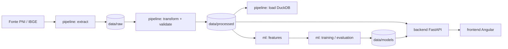

# 💉 Vax Coverage SP Analytics — Plataforma de Inteligência e Predição de Déficit Vacinal

Projeto Integrador IV (UNIVESP) para analisar a **cobertura vacinal municipal no Estado de São Paulo** e apoiar a identificação de possíveis déficits. A plataforma integra dados de vacinação, um pipeline analítico, modelos de aprendizado de máquina para classificação do déficit no ano seguinte e um dashboard interativo.

Os resultados dependem da disponibilidade e da qualidade dos dados, das populações-alvo e das metas utilizadas. As previsões são apoio à análise e não substituem a avaliação dos profissionais de saúde.

## 👥 Equipe de Desenvolvimento

- Camila Costa Amorim
- Larissa Pereira da Silva
- Leandro Rodrigues Paixão
- Luciana Pereira dos Santos Souza
- Marcos José Gomes Corrêa
- Rodrigo Batista de Oliveira
- Tiago de Oliveira Santos

## Objetivo e problema

Identificar municípios com maior déficit de cobertura vacinal, criar atributos explicativos, treinar modelos supervisionados para classificar o risco de déficit e disponibilizar os resultados em um dashboard.

- `cobertura = doses aplicadas / população-alvo × 100`
- `déficit = max(0, meta − cobertura)` (meta configurável, por imunizante quando necessário)
- classes de déficit: `baixo` (≤ 5 p.p.), `moderado` (≤ 15 p.p.), `alto` (> 15 p.p.)

> A população-alvo deve respeitar o imunizante/faixa etária; não se divide todas as doses pela população total.

## Arquitetura



O frontend nunca lê Parquet/DuckDB: consome apenas a API REST. Mais detalhes em [docs/architecture](docs/architecture/overview.md).

## Stack

| Camada | Tecnologia |
|---|---|
| Frontend | Angular 19, TypeScript, SCSS, Chart.js e d3-geo para mapa SVG com GeoJSON |
| Backend | Python, FastAPI, Pydantic, DuckDB e pandas |
| Pipeline | Python, pandas, requests, DuckDB, Parquet |
| ML | scikit-learn (Logistic Regression, Random Forest, Gradient Boosting) |
| Testes | pytest, Jasmine/Karma |
| Infra | Docker Compose (opcional), GitHub Actions |

O mapa atual utiliza **d3-geo e SVG**, não Leaflet. Sua visualização depende de um GeoJSON municipal configurado.

## Documentação técnica

- [Backend, ingestão e machine learning](docs/backend.md).
- [Frontend Angular, mapa e build](docs/frontend.md).
- [Arquitetura](docs/architecture/overview.md) e [referência da API](docs/api/endpoints.md).
- [Pipeline de dados](docs/data/pipeline.md), [fontes](docs/data/sources.md) e [pipeline de ML](docs/ml/ml-pipeline.md).
- [Dashboard e indicadores](docs/dashboard/dashboard.md).

## Estrutura do monorepo

```text
backend/    API FastAPI (api/v1, core, schemas, services, repositories) + testes + Dockerfile
frontend/   Angular (core, shared, layout, features) + testes + Dockerfile
pipeline/   extract, transform, validate, load e CLI de dados
ml/         features, training, evaluation, inference, models e CLI de ML
data/       raw, processed, external, models (conteúdo não versionado)
legacy/     dashboard Streamlit original (será removido quando o Angular tiver paridade)
notebooks/  EDA e experimentos
tests/      data, ml, integration, e2e
docs/       architecture, api, data, ml, frontend, dashboard
scripts/    bootstrap e run (PowerShell e Bash), export_openapi.py
```

## Pré-requisitos e ferramentas

| Ferramenta | Requisito e instalação |
|---|---|
| Python | [Python 3.10 ou superior](https://www.python.org/downloads/); no Windows, adicione-o ao `PATH`. |
| Node.js e npm | [Node.js](https://nodejs.org/) inclui o npm. Angular 19 aceita versões específicas a partir de Node 18.19.1, mas o bootstrap deste projeto exige Node 20.11 ou superior. Recomenda-se Node 20.11.1+ ou 22 em versões compatíveis; consulte a [matriz oficial do Angular](https://angular.dev/reference/versions). |
| Angular CLI | O projeto já instala uma CLI local com `npm ci`; instalação global é opcional: `npm install -g @angular/cli`. Consulte a [documentação oficial](https://angular.dev/tools/cli). |
| Git | [Baixar Git](https://git-scm.com/). |
| Google Chrome | Necessário para o executor padrão de testes do frontend; [download oficial](https://www.google.com/chrome/). |
| Docker Compose | Opcional para execução em contêineres; veja a [documentação oficial](https://docs.docker.com/compose/). |

Os scripts de bootstrap verificam os requisitos, mas não instalam programas do sistema.

## Execução local — Windows e PowerShell

### 1. Clonar o repositório

```powershell
git clone https://github.com/luciana-pereira/vax-coverage-sp-analytics.git
cd vax-coverage-sp-analytics
```

### 2. Preparar o ambiente

Na raiz do repositório:

```powershell
python -m venv .venv
.\.venv\Scripts\Activate.ps1
python -m pip install -r requirements.txt
if (-not (Test-Path .env)) { Copy-Item .env.example .env }
Set-Location frontend
npm ci
Set-Location ..
```

O comando `npm ci` instala as dependências a partir do lockfile, incluindo a Angular CLI local. Ajuste `.env` conforme as fontes e os caminhos disponíveis; não sobrescreva um arquivo já configurado. Se o PowerShell bloquear a ativação, siga a [orientação oficial do Python para ambientes virtuais](https://docs.python.org/3/library/venv.html#how-venvs-work) e a política de execução aplicável ao seu ambiente.

**Alternativa automatizada:** `.\scripts\bootstrap.ps1` cria o ambiente virtual, instala as dependências Python e do frontend, cria os diretórios de dados e copia `.env.example` apenas quando `.env` não existe. Use `-Force` para reinstalar dependências.

### 3. Preparar dados e modelo

A aplicação pode iniciar sem dados ou modelo, mas mostrará estados de indisponibilidade. Para gerar indicadores de cobertura e treinar o modelo, forneça primeiro:

1. Dados PNI em JSONL no caminho configurado por `RAW_FILE_NAME` ou acesso à API para extração.
2. Mapeamento de colunas em `data/external/column_mapping.json`.
3. População-alvo validada em `data/external/target_population.csv`, com `municipality_code`, `year`, `immunizer` e `population`.
4. Metas validadas por imunizante em `data/external/coverage_targets.json` e uma série histórica suficiente para treinamento.

Os caminhos podem ser alterados em `.env`. População municipal total não é substituto para a população-alvo vacinal. Consulte [o pipeline](docs/data/pipeline.md) e [as fontes](docs/data/sources.md) antes de preparar os arquivos.

Com o ambiente ativo e os insumos preparados, execute na raiz:

```powershell
# Opcional se já houver JSONL local no caminho configurado:
python -m pipeline.cli extract --year 2024

python -m pipeline.cli transform
python -m pipeline.cli validate
python -m pipeline.cli load
python -m ml.cli features
python -m ml.cli train
```

`load` exige um Parquet processado e validado; `train` exige o dataset produzido por `features`. Para validação temporal, o treino precisa de pelo menos **dois períodos rotulados** e de pelo menos duas classes no treino. Com apenas dois períodos, a seleção usa o conjunto de teste e pode ser otimista; com três ou mais períodos rotulados, há validação separada. Um único ano de dados não permite esse treino. Detalhes em [ML](docs/ml/ml-pipeline.md).

### 4. Iniciar backend e frontend

**Opção A — script automatizado**, na raiz:

```powershell
.\scripts\run.ps1
```

O script abre janelas separadas. Para iniciar um serviço, use `.\scripts\run.ps1 -Backend` ou `.\scripts\run.ps1 -Frontend`. O script verifica o ambiente virtual e as dependências do frontend mesmo quando apenas um serviço é selecionado.

**Opção B — manual**, em dois terminais PowerShell, ambos inicialmente na raiz:

Terminal 1 — backend:

```powershell
.\.venv\Scripts\Activate.ps1
$env:PYTHONPATH = "$PWD;$PWD\backend"
python -m uvicorn app.main:app --app-dir backend --reload --port 8000
```

Terminal 2 — frontend:

```powershell
Set-Location frontend
npm start
```

O módulo do projeto é `app.main:app` em `backend/app/main.py`; `uvicorn main:app` não corresponde à estrutura atual. Para encerrar, use `Ctrl+C` em cada terminal ou janela de serviço.

### 5. Acessar a aplicação

| Serviço | URL |
|---|---|
| Dashboard Angular | http://localhost:4200 |
| Saúde da API | http://localhost:8000/api/v1/health |
| Swagger UI | http://localhost:8000/docs |
| ReDoc | http://localhost:8000/redoc |
| Contrato OpenAPI | http://localhost:8000/openapi.json |

O frontend de desenvolvimento usa `http://localhost:8000/api/v1`. Se alterar host ou portas, ajuste a configuração do frontend e `CORS_ORIGINS` no backend.

### Linux/macOS/WSL

Como alternativa, execute `./scripts/bootstrap.sh` e depois `./scripts/run.sh`. Os scripts aceitam `--force` no bootstrap e `--backend` ou `--frontend` no comando de execução.

## Pipeline de dados

```powershell
python -m pipeline.cli extract --year 2024  # fonte -> data/raw (JSONL paginado, limit/offset)
python -m pipeline.cli transform   # raw -> data/processed/vaccination.parquet
python -m pipeline.cli validate    # qualidade do processado
python -m pipeline.cli load        # processado -> DuckDB (data/processed/vax.duckdb)
```

O ano é informado em tempo de execução no extract; o endpoint do PNI é construído dinamicamente a partir do ano informado.

A transformação normaliza os campos do PNI, filtra pela UF quando ela existe, mantém `sg_imunobiologico` como imunizante do raw local e associa target somente por município, ano e imunizante. População municipal total da SIDRA nunca substitui esse target.

Os dados extraídos ficam em data/raw, permitindo que transformação, validação, carga e treinamento sejam executados sem consultar novamente a API de origem.

Veja [pipeline.md](docs/data/pipeline.md) e  [sources.md](docs/data/sources.md).


## Machine Learning

```powershell
python -m ml.cli features   # cobertura, déficit, classe e dataset supervisionado
python -m ml.cli train      # compara os 3 modelos com validação temporal
python -m ml.cli evaluate   # resumo das métricas
python -m ml.cli predict    # inferência do último ano sem rótulo
```

- **Alvo:** classe de déficit do **ano seguinte**; atributos do ano corrente e defasados. A classe do próprio ano não é atributo (sem vazamento de alvo).
- **Validação temporal:** treino < validação < teste quando há pelo menos três períodos rotulados; com dois, não há validação separada.
- **Métricas:** F1, precision, recall, acurácia, matriz de confusão e baseline de persistência.

Detalhes em [docs/ml/ml-pipeline.md](docs/ml/ml-pipeline.md).

## API e Swagger

A documentação das rotas é derivada do OpenAPI real: [docs/api/endpoints.md](docs/api/endpoints.md). Para regenerar após mudar a API: `python scripts/export_openapi.py` (um teste falha se `docs/api/openapi.json` ficar desatualizado).

## Dashboard

Páginas: visão geral (KPIs, mapa, evolução, ranking, previsões), histórico, municípios, previsões, modelos e qualidade dos dados. Na visão geral é possível enviar um CSV para análise agregada temporária; o upload não substitui a execução do pipeline nem treina o modelo. A API valida arquivos de até 25 MiB e 500.000 linhas, processa-os em memória e retorna agregados. Veja [dashboard](docs/dashboard/dashboard.md) e [endpoints](docs/api/endpoints.md).

## Testes e lint

```powershell
python -m pytest                       # backend, pipeline, ML, integração e e2e
ruff check backend pipeline ml tests scripts
Set-Location frontend
npm test                               # Jasmine/Karma em Chrome headless
npm run build
Set-Location ..
```

## Docker (opcional)

```bash
docker compose up --build
```

Sobe `backend` (porta 8000, `./data` montado somente leitura) e `frontend` (porta 4200). Pipeline e treino rodam fora dos contêineres e gravam em `./data`.

## Configuração

Copie `.env.example` para `.env`. As variáveis estão comentadas no arquivo (fonte de dados, caminhos, metas, GeoJSON, host/porta e CORS).

Principais configurações:

- PNI_API_BASE_URL: base da API de dados abertos do PNI.
- IBGE_SIDRA_BASE_URL: base da API SIDRA do IBGE.
- IBGE_POPULATION_TABLE: tabela populacional utilizada.
- IBGE_POPULATION_VARIABLE: variável populacional utilizada.
- RAW_FILE_NAME: arquivo JSONL de entrada.
- DATA_DIR: diretório de dados.
- DUCKDB_PATH: banco DuckDB.
- CORS_ORIGINS: origens permitidas pela API.
- GEOJSON_PATH e GEOJSON_CODE_PROPERTY: configuração do mapa municipal.

Não versione segredos nem o arquivo `.env`.

## Dados reais e limitações

O projeto possui integração com as fontes reais do PNI e do IBGE.

Registro da auditoria de 05/11/2026; arquivos locais e resultados podem ter mudado desde então:

- `data/raw/pni_2024_sp_min.jsonl` tem 2.401.483 linhas, todas de 2024, cobrindo 645 municípios e 90 siglas `sg_imunobiologico`; o raw reduzido não contém ID único de dose, então a deduplicação está desligada;
- a resposta da API PNI completa foi validada em amostra, mas usa schema diferente (`codigo_vacina`); não há cruzamento oficial desse código para a sigla de imunizante;
- SIDRA tabela 6579/variável 9324/2024 e tabela censitária 9514/variável 93/2022 retornam população municipal total, não denominador vacinal;
- à época, `data/external/target_population.csv` e `coverage_targets.json` não estavam disponíveis. `transform`/`ml features` bloqueiam o cálculo sem população-alvo alinhada por município/ano/imunizante e metas com origem validada;
- os Parquets/DuckDB locais estão desatualizados: 645 linhas, apenas 2024, sem coluna `immunizer`. A API sinaliza cobertura indisponível;
- as categorias etárias do Censo foram consultadas, mas não há mapeamento oficial aprovado para associá-las aos imunizantes PNI; o helper exige configuração explícita e não gera targets por hipótese;
- à época, o GeoJSON municipal e o modelo treinado não estavam disponíveis. Um único ano não permite validação temporal;
- o mapa depende de GeoJSON municipal e configuração de `GEOJSON_CODE_PROPERTY`; o modelo treinado depende de artefatos não versionados;
- regressão (RMSE/MAE) não foi implementada: o problema modelado é de classificação.

## Fontes dos dados

- Ministério da Saúde — PNI / dados abertos
- IBGE — SIDRA / população municipal

Ver [docs/data/sources.md](docs/data/sources.md).

## Troubleshooting

| Sintoma | Causa provável |
|---|---|
| `bootstrap` informa requisito ausente | Instale Python/Node e reabra o terminal |
| Frontend mostra "Não foi possível conectar à API" | Backend parado ou porta diferente de `apiBaseUrl` em `frontend/src/environments` |
| Erro de CORS no navegador | Inclua a origem do frontend em `CORS_ORIGINS` |
| `ModuleNotFoundError: app` | Defina `PYTHONPATH` com a raiz e `backend` (os scripts fazem isso) |
| `transform` falha pedindo mapeamento | Verifique `data/external/column_mapping.json` (docs/data/pipeline.md) e a documentação do pipeline |
| Mapa indisponível | Forneça o GeoJSON e `GEOJSON_CODE_PROPERTY` |

## Contribuição

1. Crie uma branch a partir de `develop`.
2. Rode `pytest`, e npm test antes de abrir o PR.
3. Atualize a documentação quando mudar contratos; regenere `docs/api` com `scripts/export_openapi.py`.
4. Não versione dados, modelos treinados nem `.env`.

## Licença

MIT — ver [LICENSE](LICENSE).
