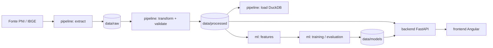

# Vax Coverage SP Analytics

Projeto Integrador IV (UNIVESP): análise em escala da **cobertura vacinal no Estado de São Paulo**, engenharia de dados, modelagem do **déficit de cobertura** e visualização em um dashboard.

## Objetivo e problema

Identificar municípios com maior déficit de cobertura vacinal, criar atributos explicativos, treinar modelos supervisionados para classificar o risco de déficit e disponibilizar os resultados em um dashboard.

- `cobertura = doses aplicadas / população-alvo × 100`
- `déficit = max(0, meta − cobertura)` (meta configurável, por imunizante quando necessário)
- classes de déficit: `baixo` (≤ 5 p.p.), `moderado` (≤ 15 p.p.), `alto` (> 15 p.p.)

> A população-alvo deve respeitar o imunizante/faixa etária; não se divide todas as doses pela população total.

## Arquitetura



O frontend nunca lê Parquet/DuckDB: consome apenas a API REST. Mais detalhes em [docs/architecture](docs/architecture/overview.md).

## Stack

| Camada | Tecnologia |
|---|---|
| Frontend | Angular 19, TypeScript, Chart.js, d3-geo |
| Backend | FastAPI, Pydantic, DuckDB (leitura de Parquet) |
| Pipeline | Python, pandas, requests, DuckDB, Parquet |
| ML | scikit-learn (Logistic Regression, Random Forest, Gradient Boosting) |
| Testes | pytest, Jasmine/Karma |
| Infra | Docker Compose (opcional), GitHub Actions |

## Estrutura do monorepo

```text
backend/    API FastAPI (api/v1, core, schemas, services, repositories) + testes + Dockerfile
frontend/   Angular (core, shared, layout, features) + testes + Dockerfile
pipeline/   extract, transform, validate, load e CLI de dados
ml/         features, training, evaluation, inference, models e CLI de ML
data/       raw, processed, external, models (conteúdo não versionado)
legacy/     dashboard Streamlit original (será removido quando o Angular tiver paridade)
notebooks/  EDA e experimentos
tests/      data, ml, integration, e2e
docs/       architecture, api, data, ml, frontend, dashboard
scripts/    bootstrap e run (PowerShell e Bash), export_openapi.py
```

## Requisitos

- Python 3.10 ou superior (CI usa 3.12)
- Node.js 20.11 ou superior e npm
- Git
- Docker é opcional (no Windows, use o Docker Engine dentro do Ubuntu/WSL; Docker Desktop não é necessário)

Os scripts de bootstrap **não instalam** software do sistema: informam o que falta.

## Instalação

### Windows (PowerShell)

```powershell
.\scripts\bootstrap.ps1          # use -Force para reinstalar dependências
.\scripts\run.ps1                # backend + frontend (use -Backend ou -Frontend)
```

### Linux/macOS/WSL

```bash
./scripts/bootstrap.sh           # use --force para reinstalar dependências
./scripts/run.sh                 # backend + frontend (--backend ou --frontend)
```

O bootstrap cria `.venv`, instala `requirements.txt` e `frontend/package-lock.json`, cria `data/*` e copia `.env.example` para `.env`.

## Execução local

| Serviço | URL |
|---|---|
| Dashboard Angular | http://localhost:4200 |
| API FastAPI | http://localhost:8000 |
| Swagger UI / ReDoc / OpenAPI | `/docs` · `/redoc` · `/openapi.json` |

Manual, sem scripts:

```powershell
$env:PYTHONPATH = "$PWD;$PWD\backend"
.\.venv\Scripts\python -m uvicorn app.main:app --app-dir backend --reload   # backend
cd frontend; npm start                                                      # frontend
```

## Pipeline de dados

```powershell
python -m pipeline.cli extract --year 2024  # fonte -> data/raw (JSONL paginado, limit/offset)
python -m pipeline.cli transform   # raw -> data/processed/vaccination.parquet
python -m pipeline.cli validate    # qualidade do processado
python -m pipeline.cli load        # processado -> DuckDB (data/processed/vax.duckdb)
```

O ano é informado em tempo de execução no extract; o endpoint do PNI é construído dinamicamente a partir do ano informado.

A transformação normaliza os campos do PNI, filtra a UF do paciente e associa a população-alvo por município, ano e imunizante quando esse campo existe. A consulta SIDRA de população municipal total é separada e não é usada como denominador vacinal.

Os dados extraídos ficam em data/raw, permitindo que transformação, validação, carga e treinamento sejam executados sem consultar novamente a API de origem.

Veja [pipeline.md](docs/data/pipeline.md) e  [sources.md](docs/data/sources.md).


## Machine Learning

```powershell
python -m ml.cli features   # cobertura, déficit, classe e dataset supervisionado
python -m ml.cli train      # compara os 3 modelos com validação temporal
python -m ml.cli evaluate   # resumo das métricas
python -m ml.cli predict    # inferência do último ano sem rótulo
```

- **Alvo:** classe de déficit do **ano seguinte**; atributos do ano corrente e defasados. A classe do próprio ano não é atributo (sem vazamento de alvo).
- **Validação temporal:** treino < validação < teste (sem split aleatório).
- **Métricas:** F1, precision, recall, acurácia, matriz de confusão e baseline de persistência.

Detalhes em [docs/ml/ml-pipeline.md](docs/ml/ml-pipeline.md).

## API e Swagger

A documentação das rotas é derivada do OpenAPI real: [docs/api/endpoints.md](docs/api/endpoints.md). Para regenerar após mudar a API: `python scripts/export_openapi.py` (um teste falha se `docs/api/openapi.json` ficar desatualizado).

## Dashboard

Páginas: visão geral (KPIs, mapa, evolução, ranking, previsões), histórico, municípios, previsões, modelos e qualidade dos dados. Veja [docs/dashboard/dashboard.md](docs/dashboard/dashboard.md).

## Testes e lint

```powershell
python -m pytest                       # backend, pipeline, ML, integração e e2e
ruff check backend pipeline ml tests scripts
cd frontend; npm test                  # Jasmine/Karma em Chrome headless
cd frontend; npm run build
```

## Docker (opcional)

```bash
docker compose up --build
```

Sobe `backend` (porta 8000, `./data` montado somente leitura) e `frontend` (porta 4200). Pipeline e treino rodam fora dos contêineres e gravam em `./data`.

## Configuração

Copie `.env.example` para `.env`. As variáveis estão comentadas no arquivo (fonte de dados, caminhos, metas, GeoJSON, host/porta e CORS).

Principais configurações:

- PNI_API_BASE_URL: base da API de dados abertos do PNI.
- IBGE_SIDRA_BASE_URL: base da API SIDRA do IBGE.
- IBGE_POPULATION_TABLE: tabela populacional utilizada.
- IBGE_POPULATION_VARIABLE: variável populacional utilizada.
- RAW_FILE_NAME: arquivo JSONL de entrada.
- DATA_DIR: diretório de dados.
- DUCKDB_PATH: banco DuckDB.
- CORS_ORIGINS: origens permitidas pela API.
- GEOJSON_PATH e GEOJSON_CODE_PROPERTY: configuração do mapa municipal.

Não versione segredos nem o arquivo `.env`.

## Dados reais e limitações

O projeto possui integração com as fontes reais do PNI e do IBGE.

Estado validado em 05/11/2026:

- o endpoint PNI de 2024 respondeu em teste de página limitada; o envelope e os campos de município, vacina, data e UF do paciente foram observados. A extração completa não foi executada;
- a SIDRA (tabela 6579, variável 9324, período 2024) respondeu com 645 municípios de SP. O valor é população municipal total, não população-alvo vacinal;
- `data/external/target_population.csv` não está disponível no repositório. Sem esse denominador (e sem uma coluna `population` canônica na entrada), `transform` agora falha explicitamente em vez de calcular cobertura com a população total;
- `codigo_vacina` é preservado como código bruto. O cruzamento oficial para grupos como SCR/INF3 e o denominador correspondente ainda precisam ser fornecidos/validados;
- os Parquets locais atuais contêm 645 municípios, mas não têm dimensão `immunizer`; a API agora os sinaliza como indisponíveis em vez de publicar cobertura sem identificação vacinal;
- não existe endpoint ou página de upload no backend/frontend. O processador de CSV é apenas uma rotina de pipeline, não um fluxo de upload ponta a ponta;
- o mapa depende de GeoJSON municipal e configuração de `GEOJSON_CODE_PROPERTY`; o modelo treinado depende de artefatos não versionados;
- regressão (RMSE/MAE) não foi implementada: o problema modelado é de classificação.

## Fontes dos dados

- Ministério da Saúde — PNI / dados abertos
- IBGE — SIDRA / população municipal

Ver [docs/data/sources.md](docs/data/sources.md).

## Troubleshooting

| Sintoma | Causa provável |
|---|---|
| `bootstrap` informa requisito ausente | Instale Python/Node e reabra o terminal |
| Frontend mostra "Não foi possível conectar à API" | Backend parado ou porta diferente de `apiBaseUrl` em `frontend/src/environments` |
| Erro de CORS no navegador | Inclua a origem do frontend em `CORS_ORIGINS` |
| `ModuleNotFoundError: app` | Defina `PYTHONPATH` com a raiz e `backend` (os scripts fazem isso) |
| `transform` falha pedindo mapeamento | Verifique `data/external/column_mapping.json` (docs/data/pipeline.md) e a documentação do pipeline |
| Mapa indisponível | Forneça o GeoJSON e `GEOJSON_CODE_PROPERTY` |

## Contribuição

1. Crie uma branch a partir de `develop`.
2. Rode `pytest`, e npm test antes de abrir o PR.
3. Atualize a documentação quando mudar contratos; regenere `docs/api` com `scripts/export_openapi.py`.
4. Não versione dados, modelos treinados nem `.env`.

## Licença

MIT — ver [LICENSE](LICENSE).
