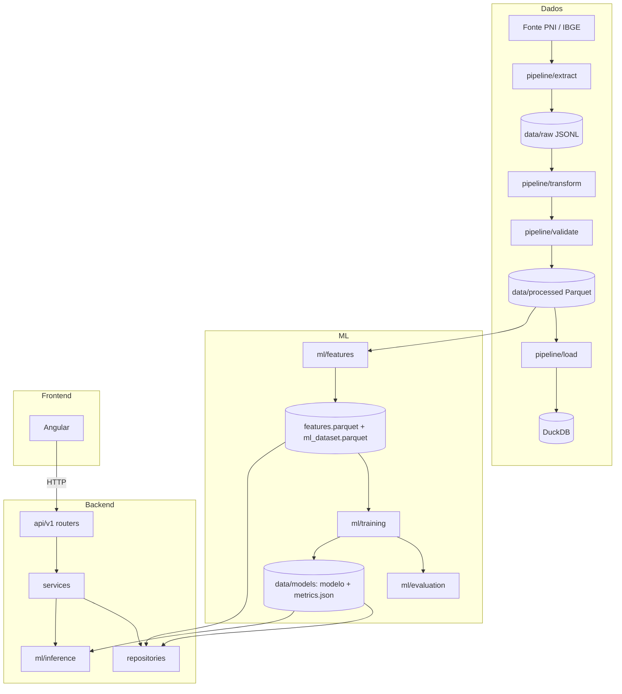
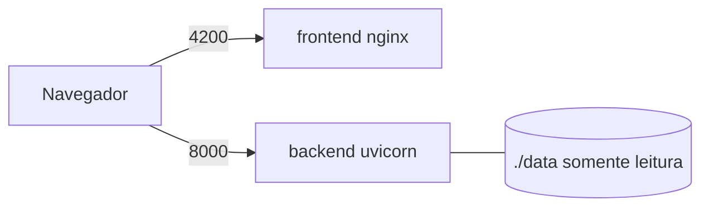
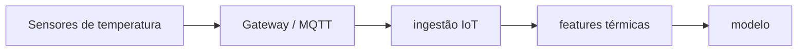

# Arquitetura

## Visão lógica

## Responsabilidades

| Camada | Responsabilidade | Não faz |
|---|---|---|
| `pipeline/` | Extrair, validar, transformar e carregar dados | Treino ou inferência |
| `ml/` | Features, treino, avaliação e inferência | Servir HTTP |
| `backend/` | Contratos REST (Pydantic), regras de negócio e leitura de dados | Treinar modelos |
| `frontend/` | Visualização e interação | Acessar DuckDB/Parquet |

Regras de dependência:

- routers (finos) → services (negócio) → repositories (persistência);
- o backend só **lê** artefatos e usa `ml.inference` para prever; o treino é executado por `ml.cli`;
- schemas Pydantic são a fonte de verdade da API (OpenAPI).

## Fluxo de dados

1. `extract` grava registros brutos paginados (`limit`/`offset`) em `data/raw`.
2. `transform` aplica o mapeamento de colunas e a população-alvo externa e grava `vaccination.parquet`.
3. `validate` verifica colunas obrigatórias, nulos, duplicatas e valores inválidos; `load` grava a tabela `vaccination` no DuckDB.
4. `ml.cli features` calcula `coverage`, `deficit`, `deficit_class` e o dataset supervisionado (alvo: classe do ano seguinte).
5. `ml.cli train` compara Logistic Regression, Random Forest e Gradient Boosting com validação temporal e grava modelo + `metrics.json`.
6. A API consulta `features.parquet` por DuckDB, expõe métricas e prevê com o modelo treinado.

## Estados "sem dados"

Sem artefatos, a API não inventa valores: responde `data_unavailable`, `model_unavailable` ou `not_trained` com uma mensagem e listas vazias. `GET /api/v1/data-quality` lista as pendências.

## Deployment

Desenvolvimento: Windows (venv, FastAPI, Angular). Docker, quando usado, roda no Ubuntu/WSL (`docker compose up --build`).

## Decisões arquiteturais

| Decisão | Motivo |
|---|---|
| Monorepo com `pipeline/`, `ml/`, `backend/`, `frontend/` | Separar responsabilidades e permitir evolução independente |
| Dois CLIs (`pipeline.cli`, `ml.cli`) | A camada de dados não importa treino/inferência |
| Alvo = classe do ano seguinte | Evita vazamento: a classe do ano deriva de `coverage`/`deficit` do mesmo ano |
| Validação temporal | Dados são séries anuais; split aleatório vazaria o futuro |
| DuckDB sobre Parquet na API | Leitura analítica local, sem servidor de banco |
| Estados `*_unavailable` | Sem dados reais no repositório; nada é fabricado |
| Streamlit mantido em `legacy/` | Preserva o dashboard existente até haver paridade no Angular |

## IoT (futuro)

Não implementado: depende de dados de sensores da rede de frio que o grupo ainda não possui.
